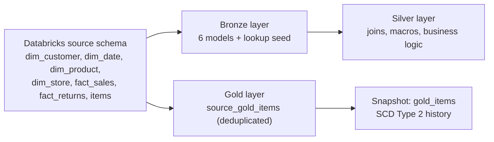
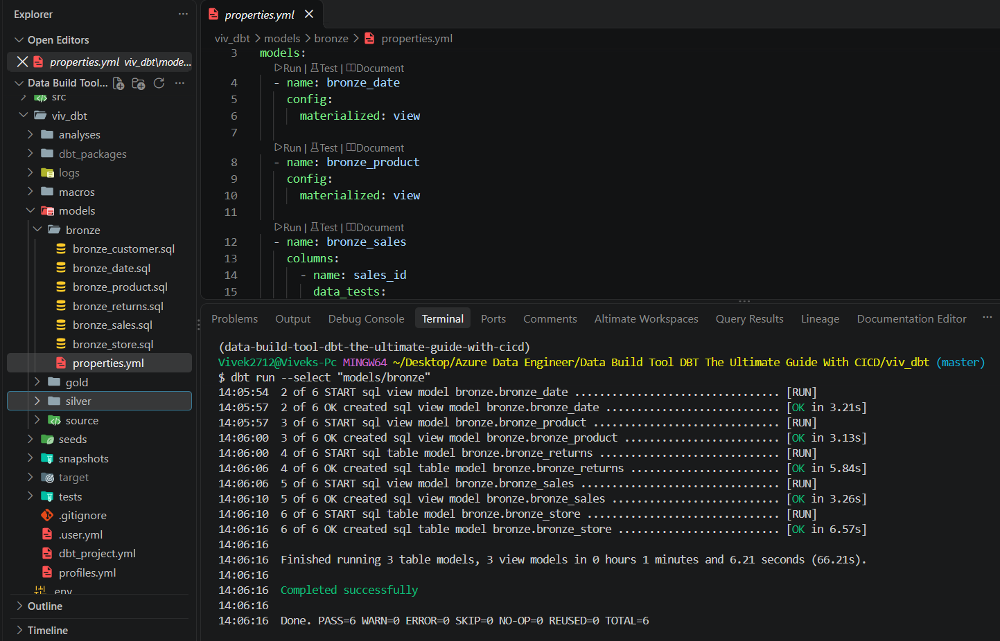
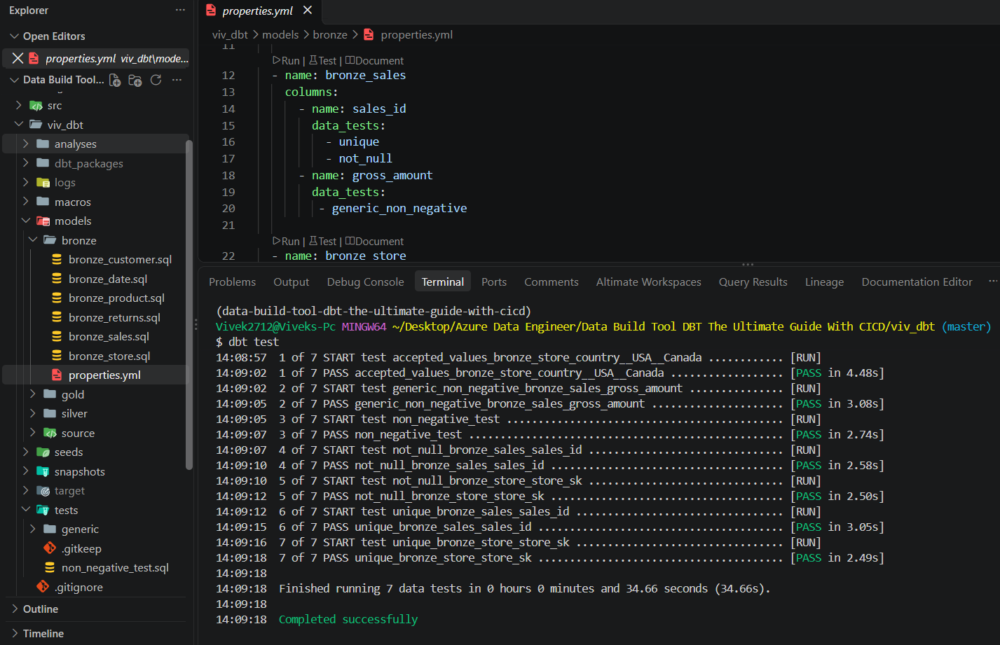
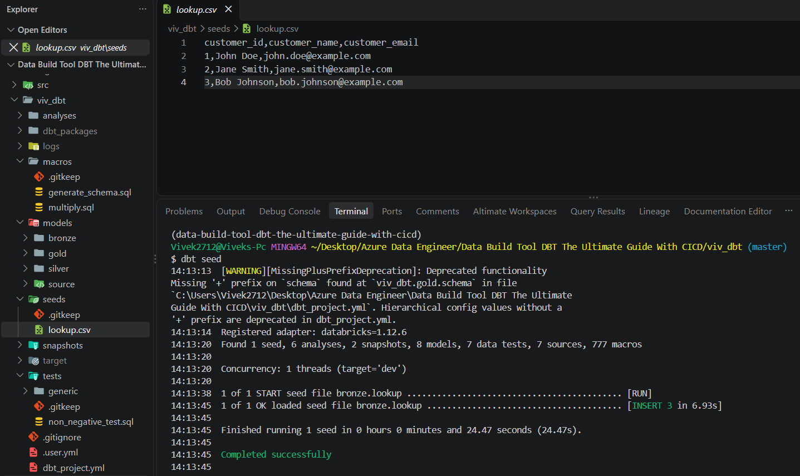
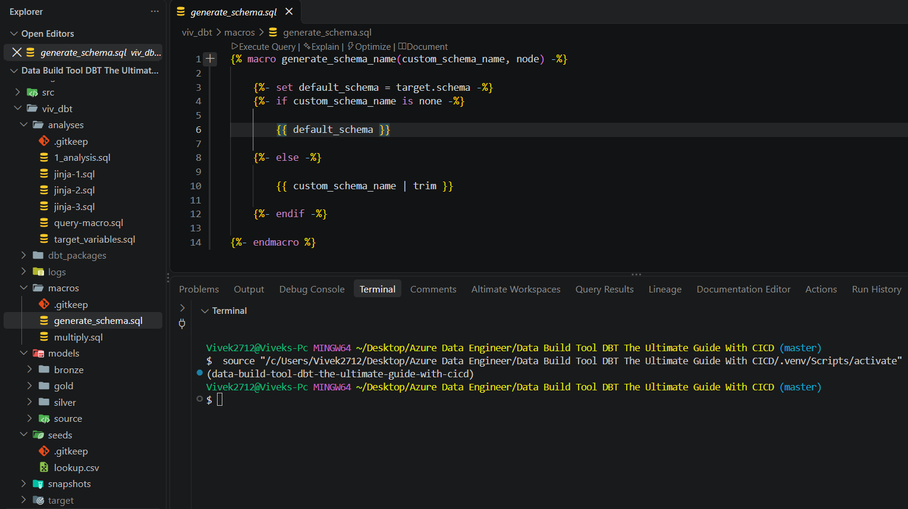
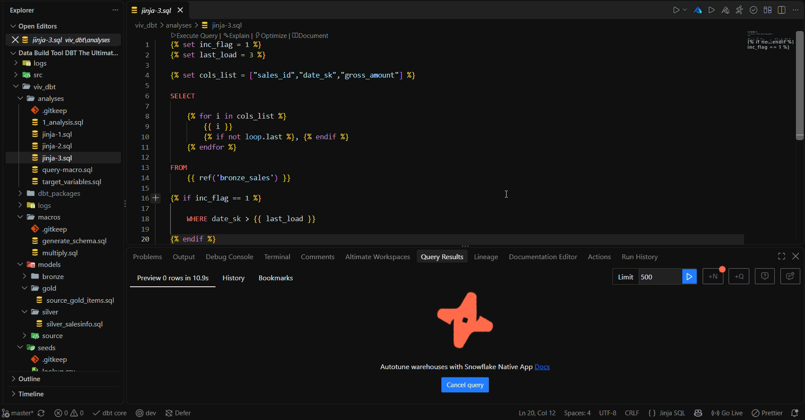
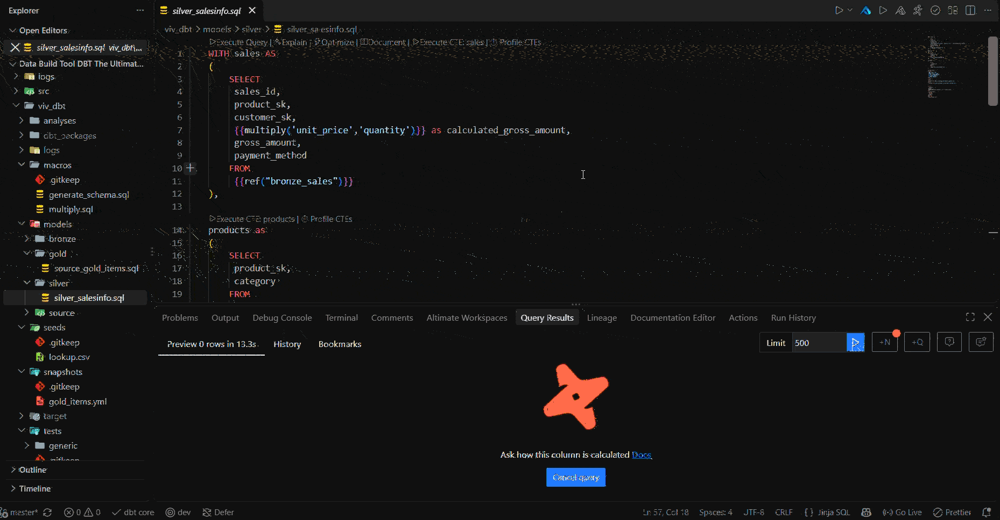
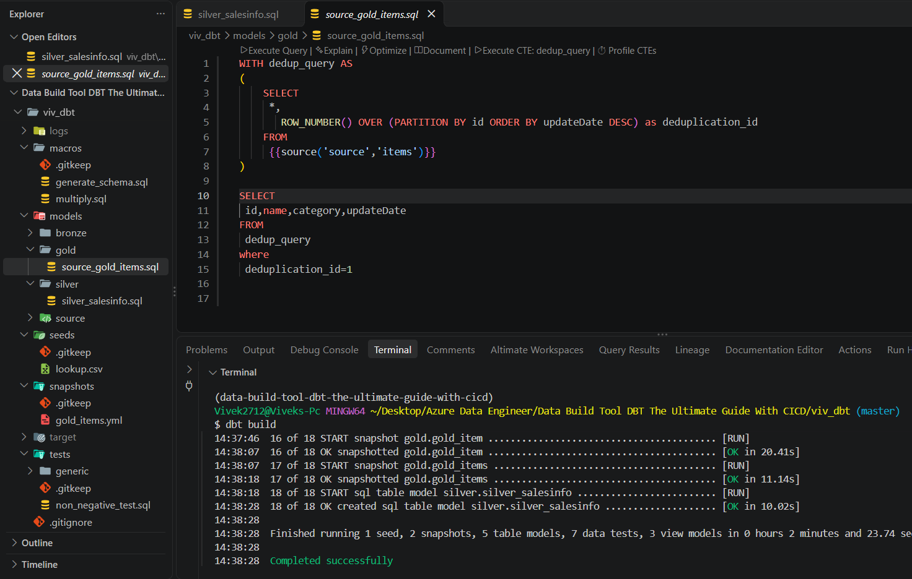

<div align="center">

# DBT + Databricks: End-to-End Data Engineering Project

</div>

**A hands-on, production-style data transformation project built with dbt Core on the Databricks Lakehouse.**
Medallion architecture · Data quality testing · Reusable Jinja macros · SCD Type 2 history tracking

<br/>


---

## 📌 About the Project

This repository documents my end-to-end journey of learning **dbt (data build tool)** by building a real transformation project on **Databricks**.

Starting from raw retail tables (customers, products, stores, dates, sales, returns and items), I built a layered **medallion** pipeline using only SQL, Jinja and YAML. Along the way I covered every core building block of dbt: sources, models, materializations, configuration, custom schemas, tests, seeds, macros, analyses and snapshots.

**What this project demonstrates**

- Setting up a modern, reproducible Python environment with **uv** and connecting **dbt Core** to **Databricks**
- Modelling data in **bronze, silver and gold** layers, each in its own schema
- Controlling how models are built using **three levels of configuration** and understanding their precedence
- Protecting data quality with **generic, singular and custom generic tests**
- Writing **reusable Jinja macros** and overriding dbt's built-in schema naming macro
- Tracking history of changing records with **SCD Type 2 snapshots**

---

## 💡 What is dbt and Why Use It?

**dbt (data build tool)** is the **"T" in ELT**. Data is first extracted and loaded into the warehouse by other tools; dbt then **transforms** it *inside* the warehouse using **SQL + Jinja**, and adds software-engineering practices on top: version control, testing, documentation and lineage.

> dbt does not extract, load or store data. It compiles your `SELECT` statements into `CREATE TABLE/VIEW AS ...` statements and the warehouse does the heavy lifting.

```
Source systems ──► Extract + Load ──► Raw tables ──► [ dbt: Transform ] ──► Clean, tested models ──► BI / Analytics
```

### dbt platforms

| Platform | Description |
|---|---|
| **dbt Core** *(used here)* | Free, open-source CLI. Run it locally or on your own infrastructure; you handle scheduling and CI yourself. |
| **dbt Cloud** | Managed platform: web IDE, job scheduler, CI/CD, hosted docs, monitoring and access control. |
| **dbt Canvas** | Visual, drag-and-drop model builder inside dbt Cloud that generates the SQL for you. |

### The backbone of dbt: models

A **model** is a single `.sql` file containing one `SELECT` statement. dbt wraps it in the right DDL (`view`, `table`, `incremental`, ...) and builds models in the correct order by reading `ref()` and `source()` calls, which form a dependency graph (**DAG**).

---

## 🏗 Architecture



| Layer | Schema | Purpose |
|---|---|---|
| **Source** | `source` | Raw tables, loaded outside dbt and declared with `sources.yml` |
| **Bronze** | `bronze` | Raw copy of each source table (single entry point into dbt) plus the `lookup` seed |
| **Silver** | `silver` | Cleaned, joined and transformed data using `ref()` and macros |
| **Gold** | `gold` | Business-ready data and snapshot history |

All objects live in the Unity Catalog catalog **`dbt_tutorial_dev`** (Databricks three-level namespace: `catalog.schema.table`).

---

## 🧰 Tech Stack

| Tool | Role |
|---|---|
| **dbt Core** + **dbt-databricks** adapter | Transformation framework |
| **Databricks** (Unity Catalog, SQL Warehouse, Delta tables) | Data platform and compute |
| **Python 3.12** | Runtime for dbt |
| **uv** | Fast Python package and virtual environment manager |
| **SQL + Jinja + YAML** | Models, macros and configuration |
| **VS Code** + **dbt Power User** extension | Development, lineage view and query preview |
| **Git + GitHub** | Version control |

---

## 📁 Repository Structure

```
.
├── pyproject.toml              # Python project definition (uv)
├── uv.lock                     # Locked dependency versions
├── requirements.txt            # Pinned packages (uv pip freeze)
└── viv_dbt/                    # dbt project
    ├── dbt_project.yml         # Project config: paths, materializations, schemas
    ├── profiles.yml.example    # Connection template (real profiles.yml is git-ignored)
    │
    ├── models/
    │   ├── bronze/
    │   │   ├── sources.yml             # Source table declarations
    │   │   ├── properties.yml          # Model configs and tests
    │   │   ├── bronze_customer.sql
    │   │   ├── bronze_date.sql
    │   │   ├── bronze_product.sql
    │   │   ├── bronze_returns.sql
    │   │   ├── bronze_sales.sql
    │   │   └── bronze_store.sql
    │   ├── silver/                     # Joined / transformed model (uses macro)
    │   └── gold/
    │       └── source_gold_items.sql   # Deduplicated source for the snapshot
    │
    ├── seeds/
    │   └── lookup.csv                  # Static reference data
    │
    ├── snapshots/
    │   └── gold_items.yml              # SCD Type 2 snapshot definition
    │
    ├── macros/
    │   ├── generate_schema.sql         # Overrides dbt's schema naming
    │   └── multiply.sql                # Reusable calculation macro
    │
    ├── tests/
    │   ├── non_negative_test.sql       # Singular test
    │   └── generic/
    │       └── generic_non_negative_test.sql   # Custom generic test
    │
    └── analyses/
        ├── jinja-1.sql                 # Variables
        ├── jinja-2.sql                 # Lists, loops, conditions
        ├── jinja-3.sql                 # Dynamic SQL
        └── jinja-4.sql                 # Calling a macro
```

---

## 🚀 Getting Started

### Prerequisites

- Python **3.12**
- [uv](https://docs.astral.sh/uv/) (`pip install uv`)
- VS Code with the Python extension (optional: **dbt Power User**)
- A **Databricks workspace** with a SQL Warehouse and a personal access token
- Raw tables created in `dbt_tutorial_dev.source`

### 1. Clone and install

```bash
git clone https://github.com/<your-username>/<your-repo>.git
cd <your-repo>

uv sync                              # create .venv and install dependencies
source .venv/Scripts/activate        # Windows (Git Bash). Mac/Linux: source .venv/bin/activate
```

> To recreate the environment from scratch: `uv init`, `uv sync`, then `uv add dbt-core dbt-databricks`, and `uv pip freeze > requirements.txt`.

### 2. Configure the connection

Copy the template and fill in your own values. **Never commit the real `profiles.yml`**: it is listed in `.gitignore`.

```bash
cp viv_dbt/profiles.yml.example viv_dbt/profiles.yml
export DATABRICKS_TOKEN=<your-personal-access-token>
```

`profiles.yml.example`:

```yaml
viv_dbt:
  target: dev
  outputs:
    dev:
      type: databricks
      catalog: dbt_tutorial_dev
      schema: default
      host: <your-workspace>.azuredatabricks.net
      http_path: /sql/1.0/warehouses/<warehouse-id>
      token: "{{ env_var('DATABRICKS_TOKEN') }}"
      threads: 4
```

### 3. Verify and run

```bash
cd viv_dbt
dbt debug          # expect: "All checks passed!"
dbt build          # seeds + models + snapshots + tests, in dependency order
```

---

## 🔨 What I Built

Each section below starts with a short explanation of the theory, followed by what I implemented.

### 1. Source layer

> **Theory:** A *source* is a raw table that already exists in the warehouse and was **not** created by dbt. Declaring it in YAML lets dbt show it in lineage, test it, and centralise its location. Models read it with `{{ source() }}`.

**Implementation:** declared the raw tables created in `dbt_tutorial_dev.source`.

```yaml
version: 2

sources:
  - name: source
    database: dbt_tutorial_dev      # a "database" in dbt = a catalog in Databricks
    schema: source
    tables:
      - name: dim_customer
      - name: dim_date
      - name: dim_product
      - name: dim_store
      - name: fact_returns
      - name: fact_sales
      - name: items
```

The tables form a small **star schema**: `dim_*` tables describe customers, products, stores and dates; `fact_sales` and `fact_returns` hold the transactions; `items` is used later for the snapshot.

---

### 2. Bronze models

> **Theory:** The bronze layer is a near-raw copy of each source and the **only** place that calls `source()`. Every later layer uses `ref()`, which makes dependencies explicit and builds the DAG.

**Implementation:** one model per source table, six in total.

```sql
-- models/bronze/bronze_product.sql
SELECT *
FROM {{ source('source', 'dim_product') }}
```

---

### 3. Configuration and precedence

> **Theory:** A model's configuration (materialization, schema, tags...) can be set in three places. The **most specific one wins**:
>
> `config()` block in the SQL file  **>**  properties YAML file  **>**  `dbt_project.yml`

**Implementation:** I defaulted the whole bronze folder to `table`, then overrode individual models to prove the precedence.

```yaml
# dbt_project.yml  (folder level, lowest priority)
models:
  viv_dbt:
    bronze:
      +materialized: table
```

```yaml
# models/bronze/properties.yml  (model level)
models:
  - name: bronze_date
    config:
      materialized: view
  - name: bronze_product
    config:
      materialized: view
```

```sql
-- models/bronze/bronze_sales.sql  (config block, highest priority)
{{ config(materialized='view') }}

SELECT * FROM {{ source('source', 'fact_sales') }}
```

| Model | Set in `dbt_project.yml` | Set in properties | Set in `config()` | Result |
|---|---|---|---|---|
| `bronze_sales` | table | – | **view** | **view** |
| `bronze_date` | table | **view** | – | **view** |
| `bronze_product` | table | **view** | – | **view** |
| `bronze_customer`, `bronze_store`, `bronze_returns` | **table** | – | – | **table** |

**Materializations:** `view` stores only the query (always fresh), `table` stores the data (rebuilt each run, fast to read). dbt also supports `incremental` and `ephemeral`.

---

### 4. Custom schemas with `generate_schema_name`

> **Theory:** By default dbt builds `<target_schema>_<custom_schema>` (for example `default_bronze`), so developers sharing a warehouse don't overwrite each other. To get exact schema names, you override dbt's built-in `generate_schema_name` macro by defining one with the same name in `macros/`.

**Implementation:** each layer is assigned a schema, and the macro uses the custom name as-is.

```yaml
# dbt_project.yml
models:
  viv_dbt:
    bronze:
      +materialized: table
      +schema: bronze
    silver:
      +materialized: table
      +schema: silver
    gold:
      +materialized: table
      +schema: gold
```

```sql
-- macros/generate_schema.sql


    

    
        {{ default_schema }}
    
        {{ custom_schema_name | trim }}
    


```

Run a single layer with a selector:

```bash
dbt run --select "models/bronze"
```

---

### 5. Data quality tests

> **Theory:** A dbt test is a query that returns the **failing rows**. **Zero rows = pass.** There are three kinds:
>
> - **Generic tests**: built-in, reusable, declared in YAML (`unique`, `not_null`, `accepted_values`, `relationships`)
> - **Singular tests**: one-off SQL files in `tests/`
> - **Custom generic tests**: your own reusable tests written with ``

**Generic tests, declared in YAML**

```yaml
# models/bronze/properties.yml
models:
  - name: bronze_sales
    columns:
      - name: sales_id
        data_tests:
          - unique
          - not_null
      - name: gross_amount
        data_tests:
          - generic_non_negative          # custom generic test (below)

  - name: bronze_store
    columns:
      - name: store_sk
        data_tests:
          - unique
          - not_null
      - name: country
        data_tests:
          - accepted_values:
              arguments:
                values: ['USA', 'Canada']
              config:
                severity: warn            # report a warning instead of failing the run
```

**Singular test**: business rule written as plain SQL

```sql
-- tests/non_negative_test.sql
SELECT *
FROM {{ ref('bronze_sales') }}
WHERE gross_amount < 0 OR net_amount < 0
```

**Custom generic test**: write once, apply to any column

```sql
-- tests/generic/generic_non_negative_test.sql


SELECT *
FROM {{ model }}
WHERE {{ column_name }} < 0


```

**Result:** all tests pass; the `accepted_values` test is configured as a warning so unexpected countries are flagged without blocking the pipeline.

```bash
dbt test
```

---

### 6. Seeds

> **Theory:** A *seed* is a small CSV file in the project that dbt loads into the warehouse as a table with `dbt seed`. Ideal for static reference data (lookups, mappings), version-controlled with the code, and referenced with `ref()`. Not meant for large or sensitive data.

**Implementation:**

```csv
customer_id,customer_name,customer_email
1,John Doe,john.doe@example.com
2,Jane Smith,jane.smith@example.com
3,Bob Johnson,bob.johnson@example.com
```

```yaml
# dbt_project.yml
seeds:
  viv_dbt:
    +schema: bronze
```

```bash
dbt seed        # creates dbt_tutorial_dev.bronze.lookup
```

> The sample data above is fictional.



---

### 7. Jinja, macros and analyses

> **Theory:** **Jinja** is a templating language that dbt renders *before* sending SQL to the warehouse, adding variables, loops, conditions and functions to SQL.
>
> | Syntax | Purpose |
> |---|---|
> | `{{ ... }}` | Print a value |
> | `` | Run logic (`set`, `if`, `for`, `macro`) |
> | `{# ... #}` | Comment |
>
> A **macro** is a reusable Jinja function that **generates SQL text**. The `analyses/` folder holds SQL that dbt *compiles but never runs*, which makes it perfect for experiments and ad-hoc queries.

**Implementation:** four progressive experiments in `analyses/`.

<details>
<summary><b>jinja-1.sql</b>: variables</summary>

```jinja
 {{ var_name }}
```
</details>

<details>
<summary><b>jinja-2.sql</b>: lists, loops and conditions</summary>

```jinja



    
        {{ i }}
    
        I hate {{ i }}
    

```
</details>

<details>
<summary><b>jinja-3.sql</b>: dynamic SQL (column list and conditional filter)</summary>

```jinja




SELECT
    
        {{ i }}, 
    
FROM {{ ref('bronze_sales') }}


    WHERE date_sk > {{ last_load }}

```

Compiles to:

```sql
SELECT sales_id, date_sk, gross_amount
FROM dbt_tutorial_dev.bronze.bronze_sales
WHERE date_sk > 3
```
</details>

<details open>
<summary><b>jinja-4.sql</b>: a reusable macro</summary>

```jinja
-- macros/multiply.sql

    {{ col1 }} * {{ col2 }}

```

```jinja
-- analyses/jinja-4.sql
SELECT {{ multiply(10, 30) }} AS test_col
```
</details>

```bash
dbt compile --select jinja-4     # inspect the generated SQL in target/compiled/
```
### Macro :


### Jinja :

---

### 8. Silver model

The silver layer joins sales with product and customer data to answer a business question: **how much did each product category sell, by customer gender?** It reuses the `multiply` macro and the bronze models via `ref()`.

```sql
WITH sales AS (
    SELECT
        sales_id,
        product_sk,
        customer_sk,
        {{ multiply('unit_price', 'quantity') }} AS calculated_gross_amount,
        gross_amount,
        payment_method
    FROM {{ ref('bronze_sales') }}
),

products AS (
    SELECT product_sk, category
    FROM {{ ref('bronze_product') }}
),

customer AS (
    SELECT customer_sk, gender
    FROM {{ ref('bronze_customer') }}
),

joined_query AS (
    SELECT
        sales.sales_id,
        sales.gross_amount,
        sales.calculated_gross_amount,
        sales.payment_method,
        products.category,
        customer.gender
    FROM sales
    JOIN products ON sales.product_sk = products.product_sk
    JOIN customer ON sales.customer_sk = customer.customer_sk
)

SELECT
    category,
    gender,
    ROUND(SUM(gross_amount), 2) AS total_sales
FROM joined_query
GROUP BY category, gender
ORDER BY total_sales DESC
```

Good practices applied: CTE-based structure, no hard-coded table names, and logic reuse through a macro.



---

### 9. Snapshots (SCD Type 2)

> **Theory:** Source tables are usually *mutable*: when a record changes, the old value is overwritten. A **snapshot** keeps the full history by implementing a **Slowly Changing Dimension Type 2**: every change adds a **new row** and closes the previous one with validity dates.
>
> dbt adds four columns: `dbt_scd_id` (unique id per version), `dbt_updated_at`, `dbt_valid_from` and `dbt_valid_to`.
>
> Snapshots need **exactly one row per `unique_key`** in each run, so the source is deduplicated first.

**Step 1: deduplicate the source** (`source_gold_items`, keeps the latest row per `id`)

```sql
WITH dedup_query AS (
    SELECT
        *,
        ROW_NUMBER() OVER (PARTITION BY id ORDER BY updateDate DESC) AS deduplication_id
    FROM {{ source('source', 'items') }}
)

SELECT id, name, category, updateDate
FROM dedup_query
WHERE deduplication_id = 1
```

**Step 2: define the snapshot** (`snapshots/gold_items.yml`)

```yaml
snapshots:
  - name: gold_items
    relation: ref('source_gold_items')
    config:
      schema: gold
      database: dbt_tutorial_dev
      unique_key: id
      strategy: timestamp                 # detect changes with an "updated at" column
      updated_at: updateDate
      dbt_valid_to_current: "to_date('9999-12-31')"   # open rows get 9999-12-31 instead of NULL
```

**Step 3: load, change, reload.** First load with three records, then insert a new version of item 3 and run `dbt build` again:

```sql
-- initial load
(1, 'item1', 'category1', '2022-01-01 00:00:00'),
(2, 'item2', 'category2', '2022-01-02 00:00:00'),
(3, 'item3', 'category3', '2022-01-03 00:00:00');

-- later: item 3 changes
(3, 'item3_new', 'category3', current_timestamp());
```

**Result in `dbt_tutorial_dev.gold.gold_items`:**

| id | name | category | updateDate | dbt_valid_from | dbt_valid_to |
|---|---|---|---|---|---|
| 1 | item1 | category1 | 2022-01-01 00:00:00 | 2022-01-01 00:00:00 | **9999-12-31** |
| 2 | item2 | category2 | 2022-01-02 00:00:00 | 2022-01-02 00:00:00 | **9999-12-31** |
| 3 | item3_new | category3 | 2026-10-10 04:44:21 | 2026-10-10 04:44:21 | **9999-12-31** *(current)* |
| 3 | item3 | category3 | 2022-01-03 00:00:00 | 2022-01-03 00:00:00 | 2026-10-10 04:44:21 *(closed)* |

Item 3 now has **two rows**: the old version was closed at the exact moment the new one became valid, with no gap and no overlap. Current records are simply those with `dbt_valid_to = '9999-12-31'`, and historical ("as of") queries become a simple date-range filter.

<!--
  CI/CD: add a short section here describing the pipeline you built in the course
  (tool used, triggers, steps such as `dbt build`, environments, secrets handling).
-->
### Snapshot :


---

## 📖 Command Reference

| Command | What it does |
|---|---|
| `uv sync` | Create the virtual environment and install dependencies |
| `uv add dbt-core dbt-databricks` | Install dbt and the Databricks adapter |
| `dbt init` | Scaffold a new dbt project and connection profile |
| `dbt debug` | Validate installation, config files and warehouse connection |
| `dbt seed` | Load CSV seeds into the warehouse |
| `dbt run` | Build **models only** (not seeds, snapshots or tests) |
| `dbt test` | Run all data tests |
| `dbt snapshot` | Run snapshots (SCD Type 2) |
| `dbt build` | Seeds + models + snapshots + tests, in DAG order |
| `dbt compile` | Render Jinja to SQL without executing (also compiles `analyses/`) |
| `dbt run --select "models/bronze"` | Run only part of the project |

---

## ✅ Advantages of dbt

| Advantage | Why it matters |
|---|---|
| **SQL-first** | Analysts and engineers share one language; no complex orchestration code to write |
| **Modular and reusable** | Small models, `ref()` dependencies and Jinja macros keep logic DRY |
| **Version controlled** | Everything is plain text, so Git, pull requests and code review work out of the box |
| **Built-in testing** | Data quality checks run alongside the transformations and can block bad data |
| **Automatic lineage** | The DAG built from `ref()`/`source()` gives dependency order and visual lineage |
| **Self-documenting** | Descriptions and tests double as living documentation |
| **Environment aware** | Targets and variables make dev to prod promotion straightforward |
| **History tracking** | Snapshots deliver SCD Type 2 with a few lines of YAML |
| **Platform-native compute** | Transformations run inside Databricks, so there is no data movement |
| **CI/CD friendly** | CLI-based and deterministic, so it fits naturally into automated pipelines |

---

## 🎓 What I Learned

- **dbt is the "T" of ELT**: it transforms data already in the warehouse and never stores or moves it itself.
- **How a run works:** dbt parses the project, builds the DAG, compiles Jinja to SQL, wraps it in DDL and runs models in dependency order.
- **`source()` vs `ref()`:** raw tables versus dbt-managed objects, and why neither should be hard-coded.
- **Materializations** control trade-offs between build time, storage and query speed.
- **Config precedence** (`config()` > properties YAML > `dbt_project.yml`) and why the most specific setting wins.
- **Schema naming:** dbt joins target and custom schema by default; overriding `generate_schema_name` gives full control.
- **A test returns bad rows**, and zero rows means success. `severity: warn` is a useful tool for soft rules.
- **Generic vs singular vs custom generic tests**, and when to choose each one.
- **Seeds** are for small, static, non-sensitive data, and `dbt run` does not load them (`dbt build` does).
- **Macros generate SQL text**; Jinja runs at compile time, not in the warehouse.
- **Snapshots** need one row per key per run, only capture the state at run time, and cannot be rebuilt, so the table must be protected.
- **Command behaviour:** `dbt run` does not execute seeds, snapshots or tests; `dbt build` runs everything in order.
- **Good habits:** keep secrets out of Git (`profiles.yml` ignored, tokens through environment variables), avoid hard-coded names and verify the compiled SQL.

---

If you found this project helpful, consider giving it a ⭐
